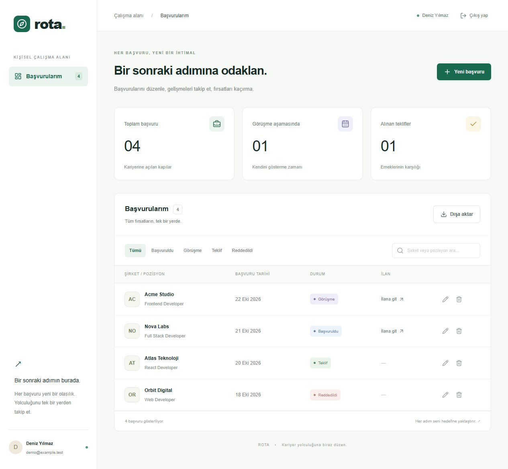
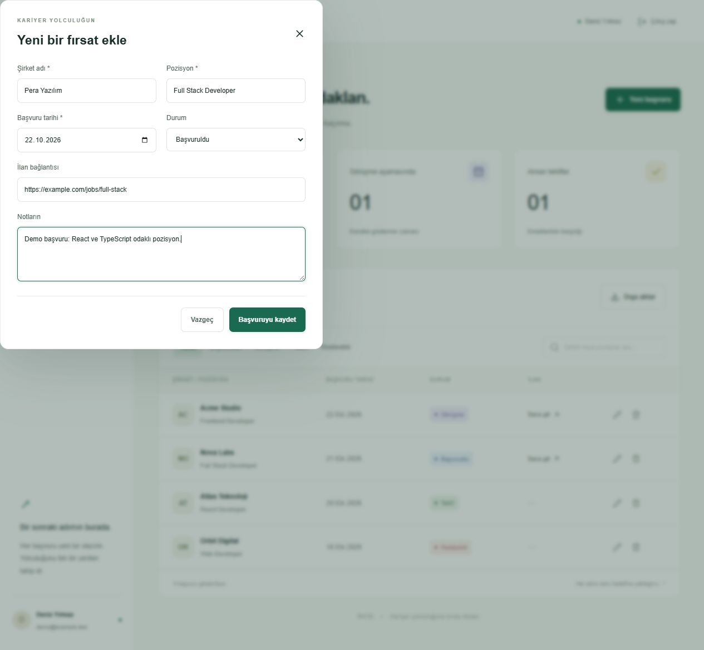
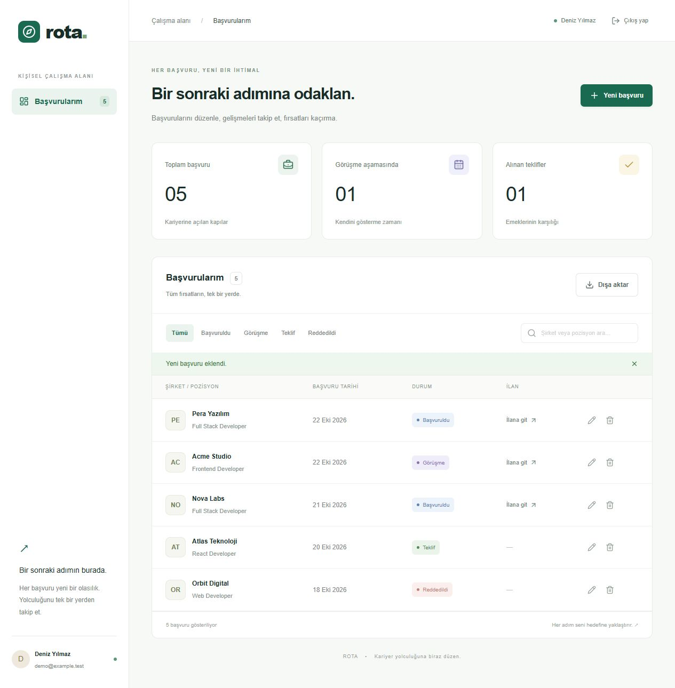
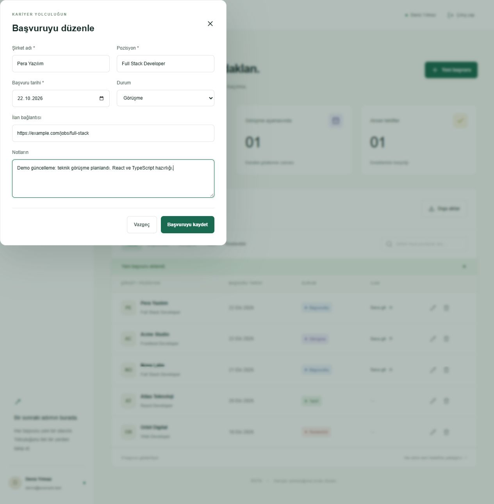
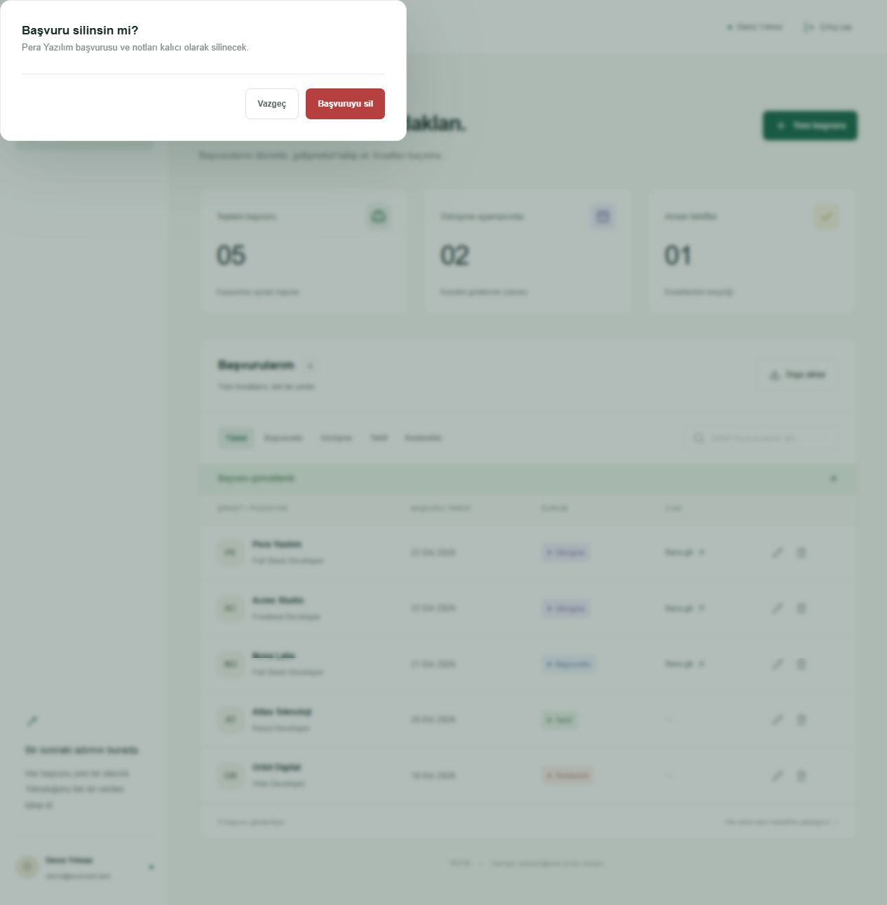
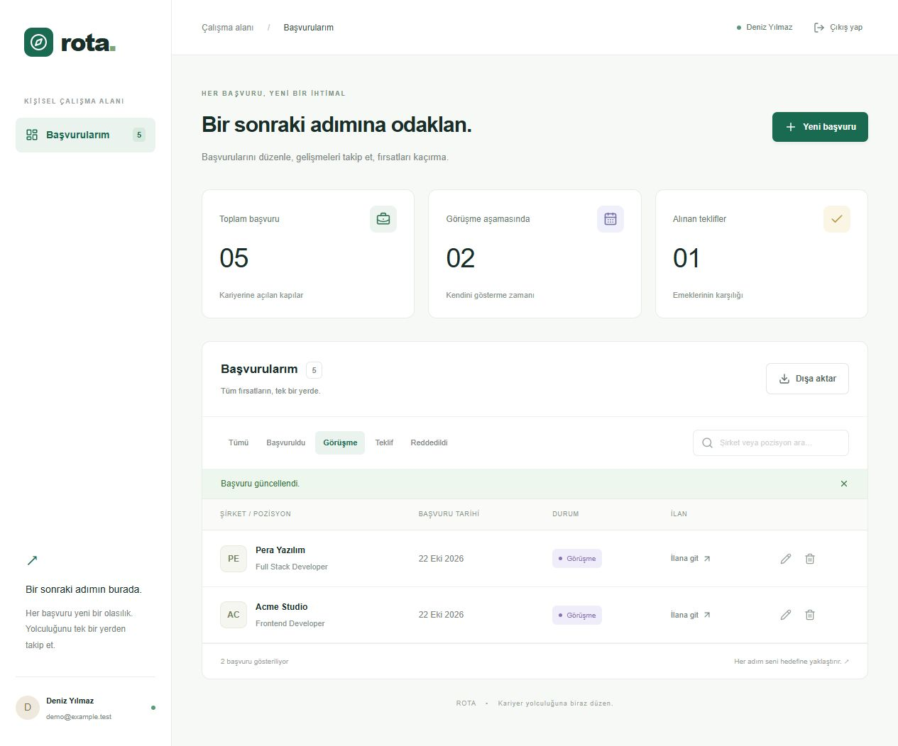
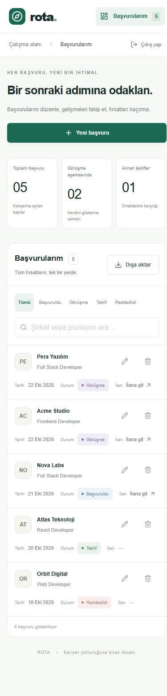
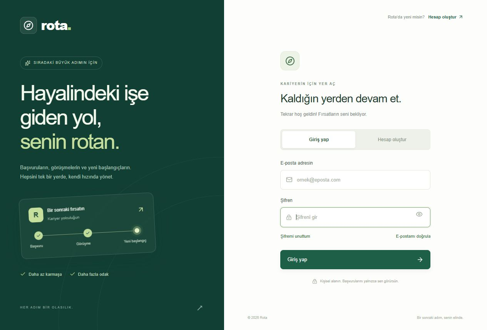
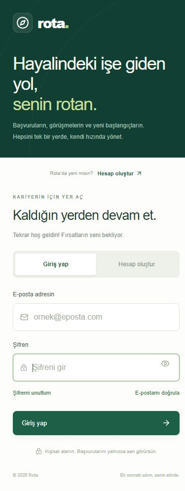
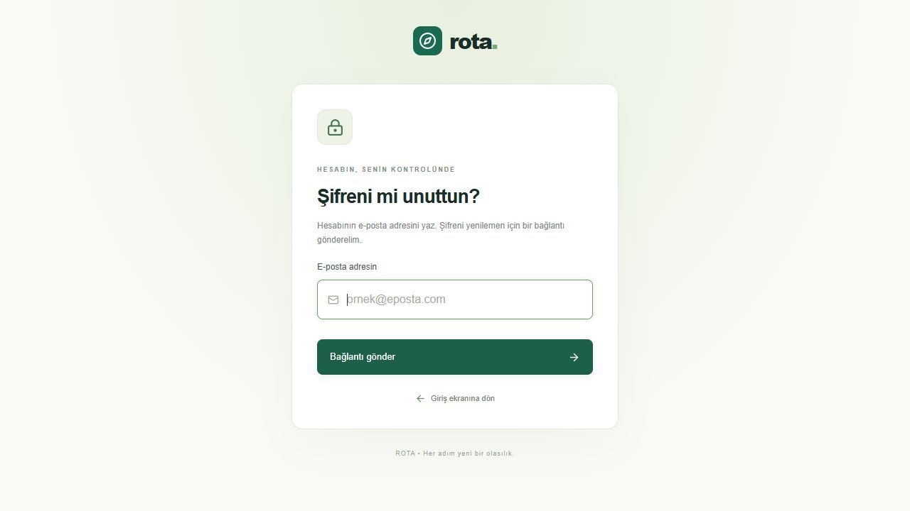

<div align="center">

# Rota

### İş başvuruların için kişisel çalışma alanın.

[](https://github.com/hazalpinaar/job-application-tracker/actions/workflows/ci.yml)
[](LICENSE)

Başvurularını, görüşmelerini ve tekliflerini tek yerde takip et. Türkçe arayüz; bilgisayar ve telefon tarayıcıları için uyumlu tasarım.

**Next.js · React · TypeScript · Tailwind CSS · Prisma · SQLite**

[Ekran görüntüleri](#ekran-görüntüleri) · [Hızlı başlangıç](#hızlı-başlangıç) · [Mobil kullanım](#mobil-kullanım) · [Komutlar](#komutlar)

</div>

## Proje hakkında

Rota, iş arama sürecindeki başvuruları ve notları tek bir yerde tutmak için geliştirilmiş Türkçe bir web uygulamasıdır. Her kullanıcı kendi hesabıyla giriş yapar ve yalnızca kendi başvurularına erişir. Masaüstünde tablo, telefon ekranlarında kart görünümü kullanılır.

> **Durum:** Yerelde çalıştırılabilir. Canlı demo henüz yayınlanmadı. Gerçek e-posta gönderimi için SMTP yapılandırması gerekir.

## Ekran görüntüleri

Aşağıdaki görseller uygulamanın çalışan sürümünden alınmıştır. Panel görüntüleri ayrı bir demo veritabanında, tamamen sahte kişi ve şirket kayıtlarıyla hazırlanmıştır; kişisel hesap veya başvuru verisi içermez.

### Ana ekran — başvuru paneli

Başvurular, durum etiketleri, görüşme ve teklif sayaçları tek ekranda takip edilir.



### Başvuru ekleme

Şirket, pozisyon, tarih, ilan bağlantısı ve notlar formdan kaydedilir.



<details>
<summary><strong>Başvuru kaydedildikten sonraki ekranı göster</strong></summary>
<br />



</details>

### Başvuru düzenleme

Kayıtlı bilgileri, notları ve başvuru durumunu güncelleyebilirsin.



### Başvuru silme onayı

Silme işleminden önce hangi başvurunun kaldırılacağını gösteren bir onay ekranı açılır.



### Duruma göre filtreleme

Örneğin yalnızca görüşme aşamasındaki başvuruları görüntüleyebilirsin.



<details>
<summary><strong>Mobil ana ekranı göster</strong></summary>
<br />
<p align="center">
  
</p>
</details>

### Masaüstü giriş ekranı



<details>
<summary><strong>Mobil görünümü göster</strong></summary>
<br />
<p align="center">
  
</p>
</details>

<details>
<summary><strong>Şifre kurtarma ekranını göster</strong></summary>
<br />



</details>

## Özellikler

- E-posta / şifre ile kayıt ve giriş; cihazlar arasında 7 günlük oturum
- Kullanıcıya özel başvurular; sunucuda her istek için yetki kontrolü
- Başvuru ekleme, düzenleme, not tutma ve onaylı silme
- Şirket / pozisyon araması, durum filtreleri ve özet sayaçları
- JSON dışa aktarma
- Masaüstünde tablo, mobilde kartlar ve dokunmaya uygun kontroller
- Şifremi unuttum: 30 dakikalık tek kullanımlık bağlantı
- E-posta doğrulama: 24 saatlik tek kullanımlık bağlantı, yeniden gönderme
- SMTP üzerinden gerçek e-posta veya yerelde dosyaya yazılan e-posta önizlemesi
- Şifre yenilendiğinde önceki tüm oturumların iptali

Başvuru durumları: **Başvuruldu → Görüşme → Teklif / Reddedildi**. Durumlar başvuru düzenleme formundan değiştirilir.

## Kullanılan teknolojiler

| Teknoloji                  | Kullanım amacı                                          |
| -------------------------- | ------------------------------------------------------- |
| Next.js App Router + React | Sayfalar, arayüz bileşenleri ve API route'ları          |
| TypeScript                 | Uygulama türleri ve statik kontrol                      |
| Tailwind CSS + CSS         | Duyarlı arayüz ve görsel tasarım                        |
| Prisma + SQLite            | Kullanıcı, başvuru, oturum ve token kayıtları           |
| Node.js Crypto             | Şifre ve token özetleri                                 |
| Nodemailer                 | Yapılandırılabilir SMTP gönderimi                       |
| GitHub Actions             | Otomatik biçim, tür, derleme ve entegrasyon kontrolleri |

## Hızlı başlangıç

Node.js **22+**, npm ve Git gerekir. Node.js 22 ile test edilmiştir.

### 1. Repoyu indir ve bağımlılıkları kur

```bash
git clone https://github.com/hazalpinaar/job-application-tracker.git
cd job-application-tracker
npm ci
```

### 2. Ortam dosyasını oluştur

`.env.example` dosyasını `.env` olarak kopyala:

```powershell
# Windows PowerShell
Copy-Item .env.example .env
```

```bash
# macOS / Linux
cp .env.example .env
```

Varsayılan veritabanı bağlantısı:

```dotenv
DATABASE_URL="file:./dev.db"
```

### 3. Veritabanını hazırla ve uygulamayı başlat

```bash
npm run db:push
npm run dev
```

[http://127.0.0.1:3000](http://127.0.0.1:3000) adresini aç ve **Hesap oluştur** sekmesini kullan. Kurulum kendi boş veritabanını oluşturur; örnek hesap veya gerçek kullanıcı verisi repoda bulunmaz.

Eski tek kullanıcılı sürümden yükseltiyorsan uygulamayı kapatıp `prisma/dev.db` dosyasını yedekle. İlk hesap, sahipsiz eski başvuruları devralır. Bunu yalnızca kendi yerel kurulumunda, uygulamayı başkalarına açmadan önce tamamla.

## E-posta yapılandırması

Varsayılan kurulum yerel kullanıma uygundur. E-posta servisi tanımlanmadan kayıt / giriş kullanılabilir; kurtarma ve yeniden doğrulama isteği, gönderimin yapılandırılmadığını açıkça belirtir.

### Yerel önizleme — gerçek e-posta göndermez

`.env` içine ekle:

```dotenv
APP_ORIGIN="http://127.0.0.1:3000"
MAIL_TRANSPORT="file"
```

Sunucuyu yeniden başlat. Şifremi unuttum veya doğrulama isteği yaptığında mesaj, `work/mail/` klasörüne JSON olarak yazılır. Dosyadaki `link` alanını tarayıcıda aç. Bu klasör şifre sıfırlama bağlantıları içerir; kimseyle paylaşma, repoya ekleme. Dosya modu yalnızca localhost / loopback adreslerinde etkinleşir.

### Gerçek SMTP gönderimi

SMTP sağlayıcından aldığın değerleri **yalnızca `.env` veya hosting'in gizli ortam değişkenlerine** ekle:

```dotenv
APP_ORIGIN="https://rota.example.com"
MAIL_TRANSPORT="smtp"
SMTP_HOST="smtp.example.com"
SMTP_PORT="587"
SMTP_USER="your-smtp-user"
SMTP_PASSWORD="your-smtp-password"
MAIL_FROM="Rota <noreply@example.com>"
REQUIRE_EMAIL_VERIFICATION="true"
```

Bu değerler örnektir; gerçek kimlik bilgileri içermez. Port 465 için doğrudan TLS, diğer portlarda zorunlu STARTTLS kullanılır. Gönderici adresini sağlayıcında doğrula. `APP_ORIGIN` sitenin tam kök adresi olmalıdır; bağlantılar ziyaretçinin gönderdiği Host başlığından üretilmez.

Doğrulama zorunlu olduğunda eski kullanıcılar da giriş ekranındaki **E-postamı doğrula** bağlantısını kullanmalıdır. Gönderim hatası olursa hesap korunur ve doğrulama bağlantısı yeniden istenebilir.

## Mobil kullanım

Bu bir **mobil uyumlu web uygulamasıdır**; App Store / Play Store paketi veya çevrimdışı uygulama değildir.

Aynı güvenilir Wi-Fi ağındaki telefondan denemek için:

```bash
npm run dev:network
```

Terminaldeki portla `http://BILGISAYARIN_YEREL_IP_ADRESI:3000` adresini aç. 3000 doluysa terminalin verdiği portu kullan. Telefondaki `127.0.0.1` bilgisayarı değil telefonu ifade eder. Kaynak kontrolü için `APP_ORIGIN` tanımlıysa, ziyaret ettiğin adresle aynı olmalıdır.

## Komutlar

| Komut                  | Görevi                                              |
| ---------------------- | --------------------------------------------------- |
| `npm run dev`          | Yerel geliştirme sunucusu                           |
| `npm run dev:network`  | Yerel ağdan geliştirme erişimi                      |
| `npm run db:push`      | Şemayı SQLite'a uygular; mevcut dosyayı sıfırlamaz  |
| `npm run typecheck`    | Route türlerini üretir ve TypeScript kontrolü yapar |
| `npm run format`       | Kod biçimlendirme                                   |
| `npm run format:check` | Kod biçimi kontrolü                                 |
| `npm run build`        | Üretim derlemesi                                    |
| `npm start`            | Üretim sunucusu                                     |
| `npm run test:auth`    | Ayrı veritabanıyla hesap ve yetki testleri          |

`Rota-Baslat.cmd`, Windows'ta derleme tamamlandıktan sonra çift tıklayarak çalıştırılabilir. Pencereyi kullanım boyunca açık tut.

GitHub Actions, `main` push'larında ve pull request'lerde kurulum, biçim, tür, derleme ve hesap akışı testlerini çalıştırır. Testler 3101 portunda ayrı sunucu / veritabanı ve sahte e-posta dosyaları kullanır; gerçek başvurulara veya e-posta servisine dokunmaz.

## Canlı yayın ve veriler

GitHub kaynak kodunu barındırır; uygulama sunucusu veya veritabanı sunmaz. Canlı demo henüz kurulmamıştır. [Dağıtım rehberi](docs/deployment.md) HTTPS, kalıcı disk ve SMTP yapılandırmasını açıklar.

- SQLite dosyası: `prisma/dev.db`. Kalıcı ve yazılabilir disk gerekir.
- `.env`, veritabanı, yedekler, yerel e-postalar ve çalışma dosyaları Git tarafından dışlanır.
- Şifreler scrypt ile tuzlanarak özetlenir; oturum ve hesap bağlantılarının veritabanında yalnızca SHA-256 özetleri saklanır.
- Oturum çerezi HttpOnly / SameSite'tır; HTTPS `APP_ORIGIN` ayarında Secure olur.
- E-posta bağlantıları tek kullanımlıdır; token URL parçasında taşınır ve sunucu erişim günlüklerine gönderilmez.
- Yeni şifre kaydı tüm eski oturumları kapatır. Sıfırlama hesabı otomatik açmaz.
- E-posta başına deneme sınırı vardır. Geniş ölçekli herkese açık hizmet için ayrıca ağ katmanında hız / istek boyutu sınırı ve izleme gerekir.

## Proje yapısı

```text
app/                   Sayfalar ve API route'ları
components/            Panel, giriş ve hesap kurtarma arayüzleri
lib/                   Veritabanı, doğrulama, oturum, e-posta ve token yardımcıları
prisma/schema.prisma   Veri modelleri
scripts/               Veritabanı hazırlama ve entegrasyon testleri
docs/                  Ekran görüntüleri ve dağıtım rehberi
.github/workflows/     Otomatik CI
```

## Katkı ve lisans

Hata veya geliştirme önerileri için [issue açabilirsin](https://github.com/hazalpinaar/job-application-tracker/issues). Değişiklikleri ayrı bir branch üzerinde yap, kodu biçimlendir ve kontrolleri çalıştırdıktan sonra pull request gönder. Gerçek kullanıcı bilgilerini testlere veya ekran görüntülerine ekleme.

[MIT lisansı](LICENSE) — © 2026 [hazalpinaar](https://github.com/hazalpinaar).

Teknik kaynaklar: [Next.js authentication](https://nextjs.org/docs/app/guides/authentication), [Node.js Crypto](https://nodejs.org/docs/latest-v22.x/api/crypto.html), [Nodemailer SMTP](https://nodemailer.com/smtp), [OWASP Forgot Password](https://cheatsheetseries.owasp.org/cheatsheets/Forgot_Password_Cheat_Sheet.html).
